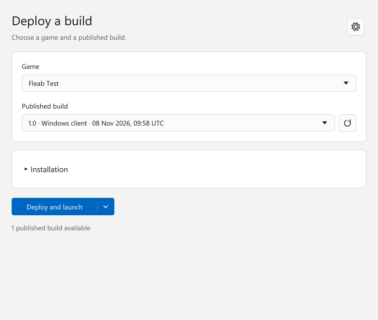
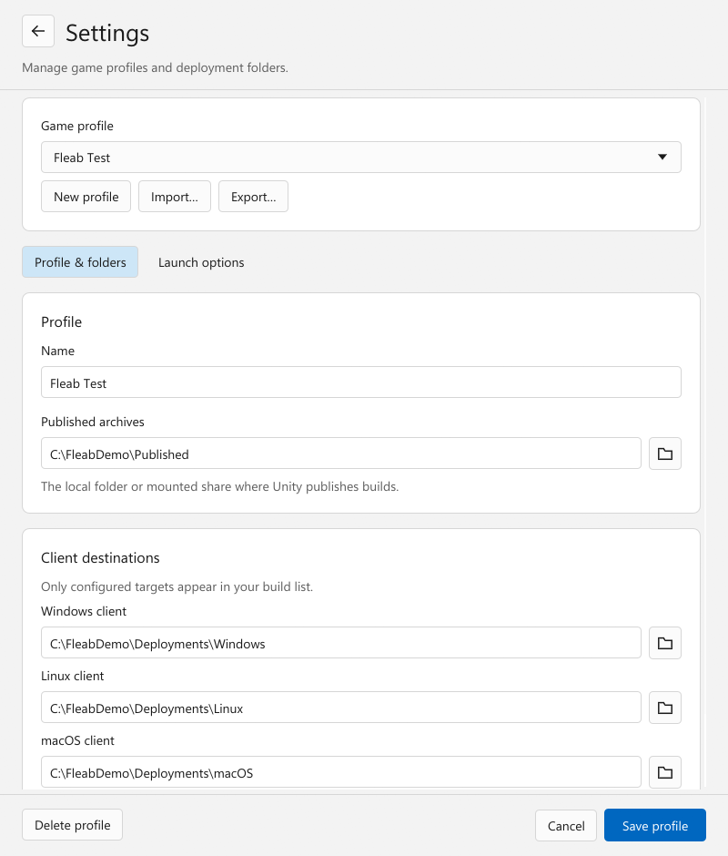

<p align="left">
  
</p>

# Fleab

Fleab helps you publish Unity game builds and install them on your test machines.
Build in Unity, publish to a shared folder, then choose, deploy and launch a build
from the portable desktop app on another computer.

- **Unity publisher** packages successful desktop builds automatically, or publishes
  your last build without rebuilding.
- **Desktop app** keeps game profiles and client/server installations separate on
  Windows, Linux and macOS.

A local folder or network share connects the two. No deployment server or
always-on target computer is needed.

<picture>
  <source media="(prefers-color-scheme: dark)" srcset="docs/screenshots/fleab-dark.png" />
  
</picture>

## Quickstart

1. In Unity Package Manager, choose **Install package from Git URL** and paste:

   ```text
   https://github.com/thestonefox/Fleab.git?path=/unity-package
   ```

2. Open **Tools > Fleab > Settings**, choose a publishing folder and enable
   automatic publishing. Build normally using Unity's Build Profiles.
3. [Download Fleab](https://github.com/thestonefox/Fleab/releases) for your test
   computer, extract it, and open the app.
4. Open the **settings cog** and create a game profile. Set the archive source
   to your publishing folder and choose a dedicated installation folder for each
   target you need. Save, select a build, then **Deploy and launch**. The button's
   dropdown also offers **Deploy only** and **Launch installed**.

Use the test computer's path to the published folder. A network share can have
different paths on different machines.

For background game shortcuts, enable **Settings > Application > Keep Fleab in
the system tray** (menu bar on macOS). Minimise and close behaviour are optional.

The Unity Git URL above follows `main`. Update the package in Unity Package
Manager to receive publisher fixes. An existing URL pinned to `#v0.8.1` keeps
that old publisher until its Git reference is changed; updating the desktop app
does not update the Unity package. Use a release tag when you want a fixed version.

<details>
<summary>See profile settings</summary>

<picture>
  <source media="(prefers-color-scheme: dark)" srcset="docs/screenshots/settings-dark.png" />
  
</picture>

</details>

## Documentation

- [Folders and profiles](docs/profiles.md) — shared folders, example setups and upgrades.
- [Unity publisher](docs/publisher.md) — configuration, manual publishing and retries.
- [Desktop app](docs/deployer.md) — deployment, launch options and system requirements.
- [Application updates](docs/updates.md) — GitHub release checks and signed updates.
- [Code signing policy](docs/code-signing.md) and [privacy](docs/privacy.md).
- [Wine, Proton and Steam Deck](docs/proton.md).
- [Development](docs/development.md), [automatic releases](docs/releases.md),
  [archive format](docs/archive-format.md) and [verification status](docs/verification.md).

## License

[MIT](LICENSE). Bundled third-party libraries retain their own licenses.
